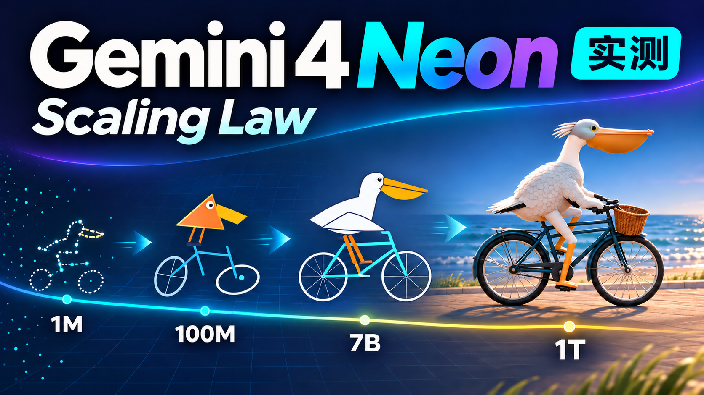
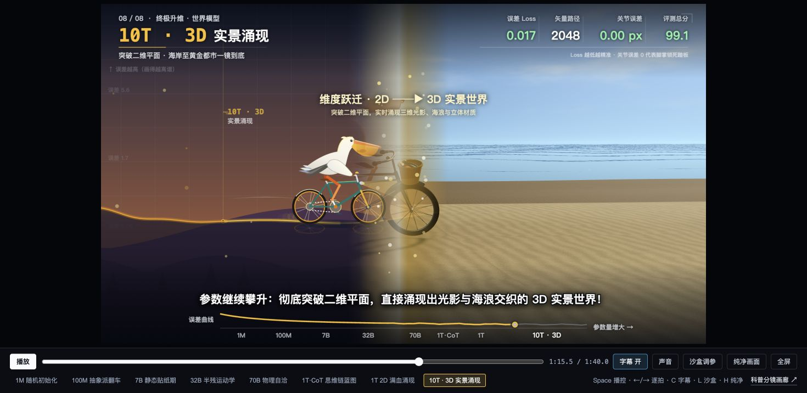

# Gemini 4 Neon 实测：涌现之路

**同一只骑车鹈鹕，从满屏噪点、悬浮三角形，一路演化到海滨 3D 世界。**

这是 [Jiale 的 AI 工坊](https://github.com/Jiale077) 使用 **Gemini 4 Neon** 制作的一次编程实测。这个仓库收录了视频《涌现之路》（The Scaling Law Ride）对应的网页项目：**100 秒动画、交互式调参实验台、程序合成音乐**，打开浏览器就能播放和探索。

[在线体验](https://jiale077.github.io/gemini4-neon-scaling-pelican/) · [观看视频](https://www.bilibili.com/video/BV1wssY6aERh/) · [关注我的 GitHub](https://github.com/Jiale077) · [MIT 许可证](./LICENSE)



> **先说明这次“实测”测什么：** 它展示的是 Gemini 4 Neon 编写动画与交互代码的效果。画面中的 1M、100M、7B、1T、10T、Loss 和评分都是叙事用的模拟设定，不是该模型的真实参数量，也不是不同模型的实际跑分结果。滑块只控制动画表现，不会调用模型 API 或改变模型权重。

## 能看到什么

- **从 2D 到 3D 的连续演进**：随机曲线 → 橙色三角鸟 → 静态贴纸 → 运动学翻车 → 顺畅骑行 → 蓝图推演 → 完整 2D → 海滨都市 3D。
- **同一套骑行骨骼的不同状态**：两段骨骼逆运动学（IK）、脚掌与踏板联动、车轮与链条同步，并能手动注入“膝盖反弯”“车轮锁死”等故障。
- **随画面变化的合成音乐**：用 Web Audio API 在浏览器中生成音轨，采用 120 BPM 的统一节拍。
- **可以自己动手的实验台**：调整参数档位和 Temperature，切换蓝图、故障预设及画面阶段。
- **代码生成画面与声音**：动画运行不加载外部图片、视频或录音；3D 部分通过 CDN 加载 Three.js。仓库封面仅作介绍，不参与动画渲染。



## 在线体验

直接打开 **[在线播放器](https://jiale077.github.io/gemini4-neon-scaling-pelican/)**，点击播放即可体验完整动画。想研究或修改代码，再按下方步骤本地运行。

## 本地运行

需要 **Node.js 20 或更新版本**。本地服务器只使用 Node.js 内置模块，**不用执行 `npm install`，不需要 API Key**。

```bash
git clone https://github.com/Jiale077/gemini4-neon-scaling-pelican.git
cd gemini4-neon-scaling-pelican
npm start
```

在浏览器中打开：

| 页面 | 地址 | 用途 |
| --- | --- | --- |
| 完整播放器 | <http://127.0.0.1:4178/> | 播放 100 秒动画、拖动时间线、切换实验台 |
| 分镜画廊 | <http://127.0.0.1:4178/gallery.html> | 浏览各阶段的代表画面与说明 |
| 独立 3D 场景 | <http://127.0.0.1:4178/world3d.html> | 体验海岸至都市的骑行与镜头控制 |

也可以直接运行 `node tools/serve.mjs`。如果 4178 端口被占用，macOS / Linux 可用 `PORT=4180 npm start`；Windows PowerShell 可先执行 `$env:PORT=4180` 再执行 `npm start`。

**播放提示：** 首次点击播放时，浏览器会合成音轨。3D 场景需要联网加载固定版本的 Three.js（0.170.0），以及浏览器硬件加速；性能受设备影响，网页实时播放不保证每台设备都达到 60 帧。100 秒 MP4 已另行导出为 4K60 与 1080P60，本仓库提供网页源码，不包含大体积成片或一键视频导出工具。

## 怎么操作

| 操作 | 效果 |
| --- | --- |
| `Space` / 点击主画面 | 播放、暂停 |
| `←` / `→` | 前后移动 0.5 秒 |
| `Shift` + `←` / `→` | 前后移动 2 秒 |
| `C` | 开关解说字幕 |
| `M` | 静音、恢复声音 |
| `L` | 开关调参实验台 |
| `H` | 开关纯净画面 |
| `F` | 切换全屏 |
| 下方阶段按钮 | 跳到对应的演化阶段 |

链接也能定位画面，例如 `http://127.0.0.1:4178/?t=75.6`。附加 `&sub=0` 隐藏字幕，`&clean=1` 隐藏 HUD；`?lab=1` 可直接打开实验台。

## 100 秒的演化路线

以下名称与时间对应当前源码，**均为创意演化示意**。

| 时间 | 阶段 | 画面变化 |
| --- | --- | --- |
| 0–4s | 开场 | 提出“鹈鹕骑车”的编程题 |
| 4–14s | 1M | 随机噪点、失控曲线 |
| 14–24s | 100M | 悬浮的橙色三角鸟、歪斜车轮 |
| 24–34s | 7B | 能认出鸟与车，轮子却像贴纸一样锁死 |
| 34–44s | 32B | 开始蹬车，但膝盖反弯、链条错拍 |
| 44–56s | 70B | 骨骼、踏板与链条逐步对齐 |
| 56–64s | 1T · CoT | 慢放蓝图，展示受力与几何标注 |
| 64–74s | 1T | 完整 2D 画面、逆光和羽毛细节 |
| 74–90s | 3D 世界 | 升维进入海岸与黄金都市 |
| 90–100s | 片尾 | 回顾演化过程 |

**关于 1T / 10T：** 发布封面末档已改为 1T；原动画源码中的 3D 阶段仍保留“10T”这一虚构标签。仓库保留视频对应的原始表现，两者都不应当作 Gemini 4 Neon 的真实规格。参数量也不是决定模型能力的唯一因素。

## 代码从哪里看

```text
index.html                 完整播放器与实验台
gallery.html               2D 分镜画廊
world3d.html               Three.js 3D 场景
render.html                Canvas 2D 定位渲染入口
src/
  main.js                  播放、跳转、2D/3D 同步及交互
  beat/                    时间线、曲线、模拟遥测数据
  rig/                     鹈鹕与自行车骨骼、IK、2D 绘制
  stages/                  开场、演化场景与片尾
  audio/                   Web Audio 音轨与乐谱
  kit/                     HUD、特效与随机数工具
public/style.css           播放器界面
tools/serve.mjs             无构建依赖的本地服务器
docs/assets/               README 封面与实机截图
```

想调整节奏与字幕，从 `src/beat/timeline.js` 开始；想研究蹬车动作，看 `src/rig/ik.js` 与 `src/rig/pelican.js`；想改变 3D 世界，看 `world3d.html`。

`render.html` 主要用于 Canvas 2D 定位预览，不能单独复现完整的 3D 合成段。完整效果请使用 `index.html`。

## 灵感与致谢

- Simon Willison 推广的“鹈鹕骑自行车”编程题。
- [orbitoo/pelican-test](https://github.com/orbitoo/pelican-test)：项目创作的灵感参考。本仓库是这次 Gemini 4 Neon 实测的动画项目，不是多模型排行榜。
- [Three.js](https://threejs.org/)：3D 场景使用的图形库，其许可证归原作者所有。

## 关注后续实测

我会继续分享 AI 编程实测、可交互的视觉项目和制作方法。喜欢这次作品，欢迎 **Star 这个仓库**，也欢迎 [Follow 我的 GitHub：@Jiale077](https://github.com/Jiale077)。

项目代码按 [MIT License](./LICENSE) 发布；引用或改编时请保留许可证中的版权与许可说明。
